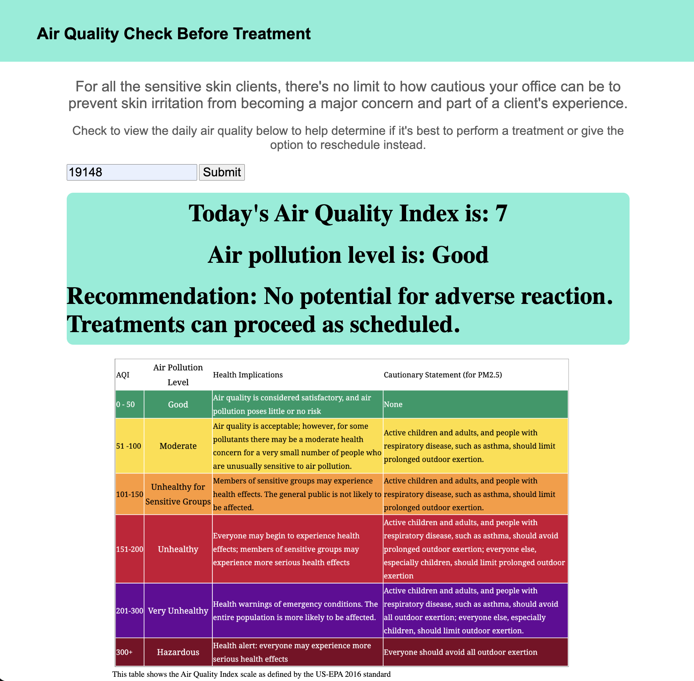

# 👩🏾‍⚕️ Project: Complex API 2 - Med Spa

### Goal: Build a simple front-end app that uses data returned from one api to make a request to another api to create something that would be beneficial to a Med Spa.

### Project Description: 
This project is meant to be used as a tool for med spas that are doing their due diligence to ensure thaat their clients don't run into any skin irritation issues post-procedure. Using the air quality index of the day in the user's area of interest, this application shares general recommendation. 

I used a geocoding API that takes in a zipcode and returns the latituded and longitude for that zipcode. I then used those coordinates as an input into the air quality API that prints the air quality index to the web page. I also included recommendations to take at different air quality index levels.

### Features: 
- Enter a zip code in the search bar and hit enter to view the air quality in your respective area. Designed for wide usage! 

### Issues: 
- My conditional logic initially began with the lowest level of air pollution and I was not getting the results printed to the web page. When I changed the conditional logic so that the lowest level of air pollution was included in the final 'else' statement, it worked.

### How to Use: 
Use the link in the about section of this repo or [CLICK HERE](https://priscilla-ruilova.github.io/Med-Spa-App/).
